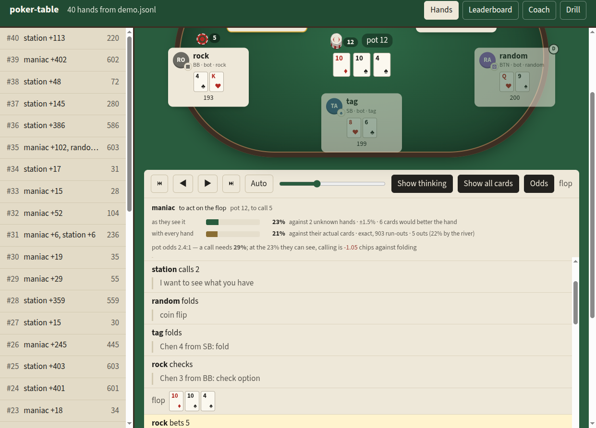

# Guide

Every command, grouped by what you want to do. Run them as `poker-table ...` after installing, or
as `uv run poker-table ...` from a clone. Nothing here needs a key unless it says so.

## Install

```sh
uv tool install git+https://github.com/amirradjou/poker-table   # or: pipx install git+https://...
```

Each release also has a wheel on the [releases page](https://github.com/amirradjou/poker-table/releases).
From a clone, `uv sync` and put `uv run` in front of every command. With Docker, from a clone:

```sh
docker compose up -d                  # a live table at http://localhost:8765
docker run --rm $(docker build -q .) play -n 200 --seats tag,maniac,station
```

## Watch, or sit down

```sh
poker-table                                     # a live table of five bots, in your browser
poker-table watch --seats me:human,tag,maniac   # sit down yourself
poker-table watch --tournament                  # a freezeout: rising blinds, play to the last seat
# a live table that keeps its hands (--pace = seconds per decision)
poker-table serve live.jsonl --live -n 200 --seats tag,maniac,llm:nerd --pace 0.8 --open
poker-table serve live.jsonl --live -n 20 --seats me:human,tag,maniac --open
```

At a table of bots, each seat's chance of winning sits under its nameplate, like a broadcast. With
you at the table those numbers stay off, because they come from everyone's cards; you get your own
odds on your turn instead, and a line from the coach after each hand.

## Play sessions and read them back

```sh
poker-table play -n 500 --seats tag,rock,maniac,station,random -o hands.jsonl
poker-table replay hands.jsonl --hand 7 -r     # one hand with every seat's reasoning
poker-table stats hands.jsonl                  # VPIP, PFR, 3-bet, AF, WTSD, W$SD, bluff %
poker-table serve hands.jsonl --open           # replay viewer and leaderboard in the browser
poker-table play -n 20 --seats me:human,tag,maniac   # sit down in the terminal

# a freezeout: rising blinds and antes, no rebuys, until one seat has every chip
poker-table play --tournament --seats tag,rock,maniac,station,random
poker-table play --tournament --levels 2/4,5/10+1,20/40+5 --level-hands 10
poker-table play -n 200 --seats tag,station --ante 1      # or a cash game with antes
```

The viewer steps through any finished hand with every seat's private reasoning beside the table.
Its filters find the long shots, turnarounds and biggest pots, and "Watch these" plays them one
after another. `serve FILE --export DIR` writes it as a static site, which is how
[the demo](https://amirradjou.github.io/poker-table/) is built. Tournaments:
[docs/tournaments.md](https://github.com/amirradjou/poker-table/blob/main/docs/tournaments.md).

## Seats

Kinds: `random`, `station`, `tag`, `rock`, `maniac`, `laya`, `human`, `llm:maniac`, `llm:rock`,
`llm:nerd`, `llm:storyteller`, and whatever an agents file defines (`poker-table agents` lists
them). Name a seat with `name:kind`, as in `me:human`.

```sh
# LLM seats run on your own key (export ANTHROPIC_API_KEY=...): kind is llm:<personality>[@model]
poker-table play -n 20 --seats llm:nerd,llm:maniac,tag,station --show -o llm.jsonl
poker-table play -n 20 --seats "ada:llm:storyteller@claude-sonnet-5,rock" --budget 1
# ... or another provider's, on your own key: openai/, groq/, openrouter/, gemini/, compat/
poker-table play -n 20 --seats llm:nerd@groq/<model>,tag,station
# ... or on a local model, free and with no key (ollama pull qwen2.5:3b)
poker-table play -n 20 --seats llm:nerd@ollama/qwen2.5:3b,tag,station --show

# your own seats: an LLM persona, a tuned bot or a Python class, in a TOML file
poker-table agents --example > agents.toml
poker-table play --agents agents.toml --seats shark,nit,tag,station
# score seats on the same graded decisions before paying for a league
poker-table eval --seats llm:nerd@ollama/qwen2.5:3b,tag -n 40
```

You pay for what your own key spends, and budgets only see Claude and OpenRouter prices. Every
model decision records the model, tokens, latency and an estimated cost. What a seat is handed,
how to write your own and what the aids are worth:
[docs/agents.md](https://github.com/amirradjou/poker-table/blob/main/docs/agents.md).

## Leagues and the leaderboard

```sh
poker-table experiment init                       # league.toml, free as written
poker-table experiment run league.toml --trial 5  # five hands, then the time and cost of the rest
poker-table experiment run league.toml --resume   # the rest, on parallel tables, into a folder
poker-table benchmark llm:nerd@ollama/qwen2.5:3b  # the fixed test behind the leaderboard
poker-table verify results/bench-tag              # deal and play a results folder again
```

A results folder has the hands, the settings and a report with error bars on every number:
[docs/experiments.md](https://github.com/amirradjou/poker-table/blob/main/docs/experiments.md).
How to add a model to the
[leaderboard](https://github.com/amirradjou/poker-table/blob/main/docs/leaderboard.md) is at its
end.

## Coach your own hands

```sh
# import a site's text export (PokerStars, GGPoker, 888poker)
poker-table import ~/Downloads/HH*.txt -o real.jsonl
poker-table coach real.jsonl --since 2026-09-01      # leaks, trend, who you leak against
poker-table drill real.jsonl -n 10                   # quiz the flagged spots (spaced repetition)
poker-table serve real.jsonl --open                  # Coach tab: leaks link to the replays
```

The coach works from charts and maths, not from a model: preflop ranges, equity and pot odds at
every decision, opponents' ranges narrowed by what they did. Claude can narrate the leaks on your
own key, and only from those facts. There is no postflop solver.

## Odds

```sh
poker-table odds "9h 8d" -b "Ts 7c 2d Kh" --vs "As Ac" --pot 60 --call 20   # against known cards
poker-table odds "Ah Kh" -b "Qh 7h 2c" --vs 2 --pot 40 --call 15            # against 2 unknown
```

The same numbers appear in the viewer at every decision and in LLM seats' prompts, so a model
spends its thinking on the read, not the arithmetic. Formulas and checks:
[docs/odds.md](https://github.com/amirradjou/poker-table/blob/main/docs/odds.md).



## Laya

```sh
uv sync --extra laya                       # pulls torch; the core install stays light
poker-table play -n 50 --seats laya,tag,station -o laya.jsonl
poker-table dataset laya.jsonl -p tag -o train.jsonl --source both   # its training set
```

What the open 421M decision model does at the table:
[docs/laya.md](https://github.com/amirradjou/poker-table/blob/main/docs/laya.md).

## How it works


- **Fair by construction.** The deck is seeded and logged, and a seat is asked through a view that
  never holds another seat's cards.
- **Illegal moves are never fatal.** Slips such as bet-for-raise or an amount off the range are
  mapped to the nearest legal move; anything else becomes a check or a fold that counts against
  the seat.
- **Personalities are prompts and settings**, so "who wins" is a question about prompts and
  models, and a league answers it.
- **Table talk** is optional free text the other seats see: bluffing in words as well as chips.
- **Every hand is a line of JSON** with each seat's private reasoning attached. Stats, the coach,
  the viewer and `verify` all read the same files.

The stack is Python 3.12+, FastAPI and a viewer with no build step. First numbers from five
scripted bots: [docs/baseline.md](https://github.com/amirradjou/poker-table/blob/main/docs/baseline.md).
