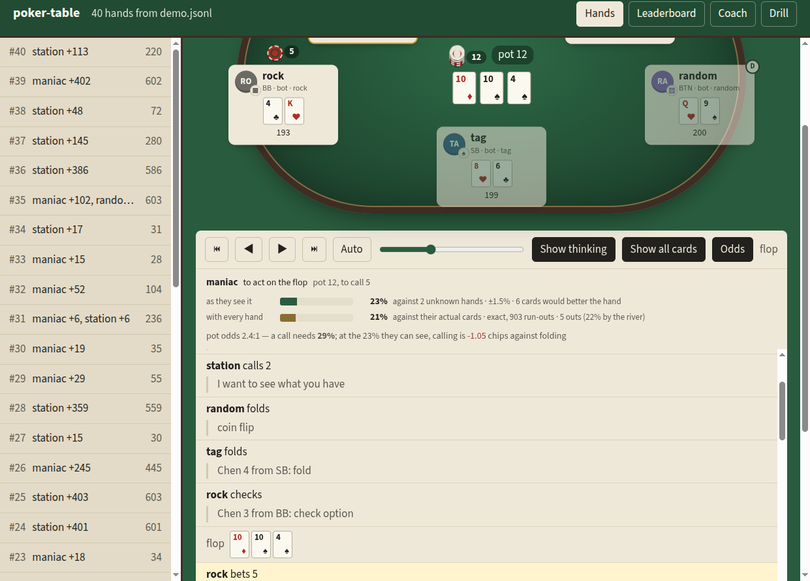

# Guide

Every command, grouped by what you want to do. Run them as `poker-table ...` after installing, or
as `uv run poker-table ...` from a clone. Nothing here needs a key unless it says so.

## Install

```sh
uv tool install git+https://github.com/amirradjou/poker-table   # or: pipx install git+https://...
```

Each release also has a wheel on the [releases page](https://github.com/amirradjou/poker-table/releases).
From a clone, `uv sync` and put `uv run` in front of every command. With Docker, from a clone:

```sh
docker compose up -d                  # a live table at http://localhost:8765
docker run --rm $(docker build -q .) play -n 200 --seats tag,maniac,station
```

## Watch, or sit down

```sh
poker-table                                     # a live table of five bots, in your browser
poker-table watch --seats me:human,tag,maniac   # sit down yourself
poker-table watch --seats ann:human,bob:human,tag,maniac --host 0.0.0.0   # with friends
poker-table watch --tournament                  # a freezeout: rising blinds, play to the last seat
# a live table that keeps its hands (--pace = seconds per decision)
poker-table serve live.jsonl --live -n 200 --seats tag,maniac,llm:nerd --pace 0.8 --open
poker-table serve live.jsonl --live -n 20 --seats me:human,tag,maniac --open
```

At a table of bots, each seat's chance of winning sits under its nameplate, like a broadcast. With
you at the table those numbers stay off, because they come from everyone's cards; you get your own
odds on your turn instead, and a line from the coach after each hand.

### Links, pictures and sound

- **Copy link**, under a replay, copies a link to that hand at that step:
  `…/#hand=17&step=9`. It works in the served viewer and on an exported site. A hand the file doesn't
  have opens the newest hand instead. The link never carries a seat's `?seat=` key. It isn't
  offered for the hands you play in the demo, because those live only in your browser.
- **Save picture** downloads a PNG of the hand's result. It shows the seats and their kinds, the
  board, the pot, who won what and the hand's number. Only cards turned over at showdown are drawn
  face up; everyone else's are backs.
- **Sound** turns on short cues for the deal, a bet or raise (a call is one chip), a check, a fold
  and the pot going to the winner, at replays and at live tables. It is off until you turn it on,
  and the browser remembers your choice. The cues are made by the page (WebAudio), and nothing
  plays until you have clicked or pressed a key on the page.

### Friends at the table

With two or more `human` seats, `watch` and `serve --live` print a private link for each person and
one to watch:

```text
Seat links. Send each one privately: whoever opens it plays that seat.
  ann    http://192.168.1.20:8770/?seat=Sq0k2opZAvBs0kyWquObjg
  bob    http://192.168.1.20:8770/?seat=EsffadQKhYleXNv0YcKhMw
  watch  http://192.168.1.20:8770/  (no seat, no cards)
Each person has 60 s a decision, then the table checks or folds for them.
```

The table runs on your machine and nothing is hosted for your friends. For other machines to reach
it, listen on your network with `--host 0.0.0.0`, or run a tunnel and name it with
`--allow-host NAME`. **The links are the only access control.** Whoever has a seat's link plays that
seat, and anyone who can reach the table can watch it, so send each link to its person only, and
use `0.0.0.0` only on a network you trust.

Each decision has 60 seconds; then the table checks if it can and folds if not. `--time-limit
SECONDS` changes that, and 0 waits for ever. Opening your link again, after a reload or a dropped
connection, picks your seat up where it was.

Each page sees what a player at a real table would. During a hand: your own cards, the actions and
table talk, and your own odds on your turn. After it: the board, every action, the cards turned over
at showdown, your own cards and your own coach line. Nobody's win chances, ever, and no commentary,
since both are worked out from every seat's cards. Folded cards stay hidden,
a bot's as well as a person's, and so does every other seat's reasoning. The watching link sees the
same without a seat. The Coach tab reads only your own seat, and Claude's notes are off, because
they would run on your key. The hand file on your machine keeps everything: `poker-table serve
FILE` shows every card and every reason once the game is over. Leave out `--seed`: the table then
picks a secret one, because anyone who knows the seed knows every card.

### Play in the demo

[The demo](https://amirradjou.github.io/poker-table/) opens on replays. Press **Play the bots**,
pick who sits down (a number takes the first that many of tag, maniac, station, rock, random and
exploiter; each name turns one bot on or off; tag, maniac and station if you don't), and press
**Deal me in**: you get a live table in the page, with
your cards, the buttons, your odds on your turn and a line from the coach after each hand. Finished
hands go to the Hands list, and the Leaderboard and Coach tabs read them. The first time, the button
downloads about 6.8 MB (Python and this package). Nothing about your game leaves the page; Pyodide
itself comes from jsDelivr. The demo has
scripted bots only: model seats need a key or a local model, so run those on your machine.

The bar under the header shows your seed and the `poker-table play` command that deals the same
hands. Make the same moves there and the hands come out the same. To deal a seed of your choice,
add it to the address: `https://amirradjou.github.io/poker-table/?seed=42`.

To build the demo yourself, with a few hands and the table to play:

```sh
scripts/build_demo.sh site 50                  # or, by hand:
uv build --wheel -o dist
poker-table serve hands.jsonl --export site --export-play dist/poker_table-*.whl
python3 -m http.server -d site 8000            # any static server will do
```

How it works:

- **Python in the browser.** [Pyodide](https://pyodide.org) 314.0.7 (Python 3.14.2) loads from
  jsDelivr into a Web Worker, so the page stays responsive. It installs this package's own wheel
  without its dependencies: FastAPI, uvicorn and the Anthropic SDK are for the server and the model
  seats, and the table needs neither. Nothing loads until you press Play.
- **One step at a time.** Code in a page cannot stop and wait for a click. A worker could wait, but
  only with shared memory, which needs headers GitHub Pages cannot send. So the page drives the
  table: each step deals a hand or lets one bot decide, and the table stops at your turn and at the
  end of each hand. The page waits between steps, as a live table's pace does.
- **The same table.** The seats are built and dealt by the code `poker-table play` runs, and the
  viewer is the one a live table uses. `web/demo_play.py` answers the viewer's requests the way the
  server does, from the same functions, so the page cannot tell the difference.

## Play sessions and read them back

```sh
poker-table play -n 500 --seats tag,rock,maniac,station,random -o hands.jsonl
poker-table replay hands.jsonl --hand 7 -r     # one hand with every seat's reasoning
poker-table stats hands.jsonl                  # VPIP, PFR, 3-bet, AF, WTSD, W$SD, bluff %
poker-table serve hands.jsonl --open           # replay viewer and leaderboard in the browser
poker-table play -n 20 --seats me:human,tag,maniac   # sit down in the terminal

# a freezeout: rising blinds and antes, no rebuys, until one seat has every chip
poker-table play --tournament --seats tag,rock,maniac,station,random
poker-table play --tournament --levels 2/4,5/10+1,20/40+5 --level-hands 10
poker-table play --tournament --seats nash:pushfold,tag   # heads-up: the chart plays the short end
poker-table play -n 200 --seats tag,station --ante 1      # or a cash game with antes
```

The viewer steps through any finished hand with every seat's private reasoning beside the table.
Its filters find the long shots, turnarounds and biggest pots, and "Watch these" plays them one
after another. `serve FILE --export DIR` writes it as a static site, which is how
[the demo](https://amirradjou.github.io/poker-table/) is built. Tournaments:
[docs/tournaments.md](https://github.com/amirradjou/poker-table/blob/main/docs/tournaments.md).

## Seats

Kinds: `random`, `station`, `tag`, `rock`, `maniac`, `laya`, `human`, `llm:maniac`, `llm:rock`,
`llm:nerd`, `llm:storyteller`, `nash:pushfold`, `cfr:blueprint`, and whatever an agents file
defines (`poker-table agents` lists them). Name a seat with `name:kind`, as in `me:human`.
The two solver seats play heads-up only (`--seats me:human,cfr:blueprint`); what they are and how
they measure: [docs/solver-seats.md](https://github.com/amirradjou/poker-table/blob/main/docs/solver-seats.md).
The papers behind them, and why the others are not seats:
[docs/research-seats.md](https://github.com/amirradjou/poker-table/blob/main/docs/research-seats.md).

```sh
# LLM seats run on your own key (export ANTHROPIC_API_KEY=...): kind is llm:<personality>[@model]
poker-table play -n 20 --seats llm:nerd,llm:maniac,tag,station --show -o llm.jsonl
poker-table play -n 20 --seats "ada:llm:storyteller@claude-sonnet-5,rock" --budget 1
# ... or another provider's, on your own key: openai/, groq/, openrouter/, gemini/, compat/
poker-table play -n 20 --seats llm:nerd@groq/<model>,tag,station
# ... or on a local model, free and with no key (ollama pull qwen2.5:3b)
poker-table play -n 20 --seats llm:nerd@ollama/qwen2.5:3b,tag,station --show

# your own seats: an LLM persona, a tuned bot or a Python class, in a TOML file
poker-table agents --example > agents.toml
poker-table play --agents agents.toml --seats shark,nit,tag,station
# score seats on the same graded decisions before paying for a league
poker-table eval --seats llm:nerd@ollama/qwen2.5:3b,tag -n 40
```

You pay for what your own key spends, and budgets only see Claude and OpenRouter prices. Every
model decision records the model, tokens, latency and an estimated cost. What a seat is handed,
how to write your own and what the aids are worth:
[docs/agents.md](https://github.com/amirradjou/poker-table/blob/main/docs/agents.md).

## Leagues and the leaderboard

```sh
poker-table experiment init                       # league.toml, free as written
poker-table experiment run league.toml --trial 5  # five hands, then the time and cost of the rest
poker-table experiment run league.toml --resume   # the rest, on parallel tables, into a folder
poker-table benchmark llm:nerd@ollama/qwen2.5:3b  # the fixed test behind the leaderboard
poker-table verify results/bench-tag              # deal and play a results folder again
```

How every bot does against every other, heads-up, with an interval on each cell:
[docs/who-beats-whom.md](https://github.com/amirradjou/poker-table/blob/main/docs/who-beats-whom.md).

A results folder has the hands, the settings and a report with error bars on every number:
[docs/experiments.md](https://github.com/amirradjou/poker-table/blob/main/docs/experiments.md).
With `tournaments = 12` in place of `hands` (the starter shows how), the same commands play
freezeouts and rank the seats by where they finish:
[docs/tournaments.md](https://github.com/amirradjou/poker-table/blob/main/docs/tournaments.md#many-freezeouts-in-one-file).
How to add a model to the
[leaderboard](https://github.com/amirradjou/poker-table/blob/main/docs/leaderboard.md) is at its
end.

Our seats are also measured against Slumbot, a strong public heads-up bot, on its own server and
at its own 200 big blinds. It deals there, so it is a benchmark and never a seat:
[docs/slumbot.md](https://github.com/amirradjou/poker-table/blob/main/docs/slumbot.md).

## Coach your own hands

```sh
# import a site's text export (PokerStars, GGPoker, 888poker)
poker-table import ~/Downloads/HH*.txt -o real.jsonl
poker-table coach real.jsonl --since 2026-09-01      # leaks, trend, who you leak against
poker-table drill real.jsonl -n 10                   # quiz the flagged spots (spaced repetition)
poker-table serve real.jsonl --open                  # Coach tab: leaks link to the replays
```

The coach works from charts and maths, not from a model: preflop ranges, equity and pot odds at
every decision, opponents' ranges narrowed by what they did. Claude can narrate the leaks on your
own key, and only from those facts. There is no postflop solver.

## Odds

```sh
poker-table odds "9h 8d" -b "Ts 7c 2d Kh" --vs "As Ac" --pot 60 --call 20   # against known cards
poker-table odds "Ah Kh" -b "Qh 7h 2c" --vs 2 --pot 40 --call 15            # against 2 unknown
```

The same numbers appear in the viewer at every decision and in LLM seats' prompts, so a model
spends its thinking on the read, not the arithmetic. Formulas and checks:
[docs/odds.md](https://github.com/amirradjou/poker-table/blob/main/docs/odds.md).



## Laya

```sh
uv sync --extra laya                       # pulls torch; the core install stays light
poker-table play -n 50 --seats laya,tag,station -o laya.jsonl
poker-table dataset laya.jsonl -p tag -o train.jsonl --source both   # its training set
```

What the open 421M decision model does at the table:
[docs/laya.md](https://github.com/amirradjou/poker-table/blob/main/docs/laya.md).

## How it works


- **Fair by construction.** The deck is seeded and logged, and a seat is asked through a view that
  never holds another seat's cards.
- **Illegal moves are never fatal.** Slips such as bet-for-raise or an amount off the range are
  mapped to the nearest legal move; anything else becomes a check or a fold that counts against
  the seat.
- **Personalities are prompts and settings**, so "who wins" is a question about prompts and
  models, and a league answers it.
- **Table talk** is optional free text the other seats see: bluffing in words as well as chips.
- **Every hand is a line of JSON** with each seat's private reasoning attached. Stats, the coach,
  the viewer and `verify` all read the same files.

The stack is Python 3.12+, FastAPI and a viewer with no build step. First numbers from five
scripted bots: [docs/baseline.md](https://github.com/amirradjou/poker-table/blob/main/docs/baseline.md).
